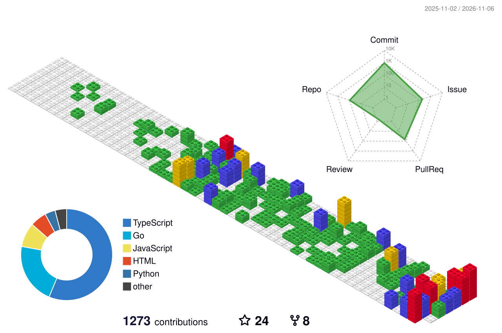

<!-- Badges + counters -->

  
  

  
  
  

  

---

Self-taught developer. Interested in AI development and productivity tools. Curious about math, physics, education, history, politics, music, and art — revisiting them through the lens of AI.

---

## Featured Projects

<!-- Replace the projects below with your own -->

<!-- innate_apps starts -->
Innate apps are built on a set of [base frameworks](#base-frameworks) and shipped as independent [applications](#apps-maintained).
Project registry maintained in [qdriven/innate-apps](https://github.com/qdriven/innate-apps) (`registry/apps.json`).

### Apps (maintained)
| Project | What it does | Status |
|---|---|---|
| [innate-daily](https://github.com/variableway/innate-daily) | personal github repo dashboard for building in public, always in working in process | maintained |
| [innate-fe-examples](https://github.com/qdriven/innate-fe-examples) | Frontend examples for quick development | maintained |
| [innate-vytdl](https://github.com/qdriven/innate-vytdl) | vYtDL CLI — Go/TUI wrapper around yt-dlp with embed and auto-download（远程仓库已存在，本地暂未检出） | maintained |
| [innate-feeds](https://github.com/variableway/innate-feeds) | Github Trending and Starred Repo | maintained |
| [spark-cli](https://github.com/variableway/spark-cli) | Daily Cli command ideas fired by spark | maintained |
| [innate-keepthem](https://github.com/variableway/innate-keepthem) | keep different resources and to know more | maintained |
| [innate-executable](https://github.com/variableway/innate-executable) | executable tutorials website and desktop version | maintained |
| [tutorials-maker](https://github.com/qdriven/tutorials-maker) | 教程生成工作台，含 agent-learning-workbench 教程学习环境 | maintained |
| [cn-textbook-downloader](https://github.com/qdriven/cn-textbook-downloader) | ChinaTextbook 教材批量下载 CLI/TUI（uv + typer + textual）：断点续传、SHA 校验、PDF 分块合并 | maintained |
| [susu-edu-workspace](https://github.com/qdriven/susu-edu-workspace) | Susu Edu：单学生、本地优先的初中数学补学应用（知识图谱 + 补学闭环） | maintained |
| [MangoDisk](https://github.com/harry0703/MangoDisk) | Safety-first disk cleaner and space analyzer for macOS, Windows and Linux | maintained |
| [fire-skills](https://github.com/variableway/fire-skills) | Personal AI Agent Skills Collection | maintained |
| [skill-management](https://github.com/qdriven/skill-management) | Skill 管理与分发工具 | maintained |

### Apps (experimental)
| Project | What it does | Status |
|---|---|---|
| [dsh-innate-agent](https://github.com/qdriven/dsh-innate-agent) | Local experiment fork of deepseek-ai/dsh-superagent-prototype: GitHub-optional deployment, localboard Sourc... | experimental |

### Base Frameworks
| Project | What it does | Status |
|---|---|---|
| [innate-fe](https://github.com/variableway/innate-fe) | base frontend framework for innate apps | maintained |
| [innate-backend](https://github.com/variableway/innate-backend) | base backend framework for innate apps | maintained |
| [innate-desktop](https://github.com/qdriven/innate-desktop) | base desktop app project for innate apps | maintained |

### Reference Projects
| Project | What it does | Status |
|---|---|---|
| [AIHOT](https://github.com/KKKKhazix/AIHOT) | 一个自己找热点、自己写日报的网站框架。 | maintained |
| [khazix-skills](https://github.com/KKKKhazix/khazix-skills) | 数字生命卡兹克开源的 AI Skills 合集 | maintained |
| [ai-aug-edu](https://github.com/HytidelLegend/ai-aug-edu) | AI 增强教育项目参考实现 | maintained |
| [word-atlas](https://github.com/designfuchen/word-atlas) | 词光 · Word Atlas — Illustrated IELTS vocabulary with 7,298 words, UK/US audio and FSRS review. | maintained |
<!-- innate_apps ends -->

  <!-- Pin your best repos here -->
  <!--
  
  -->

---

## Tech Stack

  

  
  
  
  
  
  

---

<!--
## Tech Wire

*Live -- refreshed every 6 hours by a GitHub Action from dev community feeds.*
See docs/live-feeds.md. Uncomment this heading when you want the section visible.
-->

<!-- NEWS:START -->
<!-- NEWS:END -->

---

<!--
## Latest Posts

See docs/live-feeds.md. Uncomment this heading when you want the section visible.
-->

<!-- BLOG:START -->
<!-- BLOG:END -->

---

## GitHub Analytics

  
<strong>Open stats dashboards</strong>

  

    
  

  

    
    
  

  

    
  

---

  

